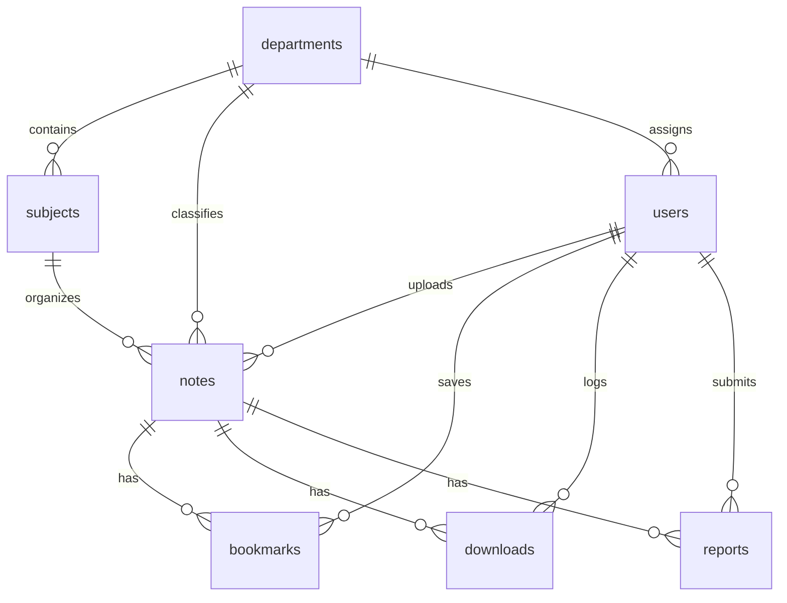

# Student Notes Sharing Platform
> **Tagline:** *"Learn Together. Share Knowledge. Grow Together."*  
> **Academic Level:** BE CSE Web Technology Laboratory Project (Full-Stack Web Application)  
> **Status:** Production-Ready • Fully Functional • Normalized Relational Database • Role-Based Access Control

---

## 1. Project Overview

The **Student Notes Sharing Platform** (`NoteShare Hub`) is a full-stack, responsive, and secure academic repository engineered to facilitate peer-to-peer knowledge exchange across engineering departments. Designed specifically for academic evaluation, laboratory demonstration, and portfolio presentation, this platform replaces informal, fragmented cloud links with an organized, curated, and syllabus-aligned educational hub.

### Key Highlights:
- **No Heavy Framework Overhead:** Pure HTML5, modern CSS3 (Custom Properties), Vanilla JavaScript, PHP 8+, and MySQL using Apache/XAMPP.
- **SaaS-Grade Visual Design:** Minimalist typography (Plus Jakarta Sans), subtle gradients, rounded cards, soft drop shadows, and responsive layouts inspired by Linear, Notion, and Coursera.
- **Strict Security Architecture:** PDO prepared statements, Bcrypt password hashing (`password_hash`), CSRF tokens on all state-altering forms, strict PDF MIME-type verification, and `.htaccess` upload execution prevention.
- **Comprehensive Admin Suite:** Analytics dashboard with Chart.js visual charts, user role promotion/demotion, note moderation, curriculum management, and a content flag review queue.
- **1-Click Setup Wizard:** Built-in web installer (`setup.php`) for instant database migration and verification.

---

## 2. Technology Stack

| Layer | Technologies Used |
|---|---|
| **Frontend** | HTML5, CSS3 (Modern SaaS Design Tokens), Vanilla JavaScript (ES6+ AJAX), Bootstrap 5 (Grid & Modal components), Font Awesome 6.5.1 |
| **Data Visualizations** | Chart.js 4.4.1 (Doughnut & Bar Charts in Admin Analytics) |
| **Backend** | PHP 8.0+ (Object-Oriented PDO Abstraction, Session Security, CSRF Tokens) |
| **Database** | MySQL (7 Normalized InnoDB Relational Tables with Foreign Keys & Cascade Rules) |
| **Server & Runtime** | Apache HTTP Server (XAMPP for Windows/macOS/Linux) |
| **File Formats** | Validated PDF (`application/pdf`) up to 25MB with browser preview |

---

## 3. Project Directory Structure

```
NoteSharing/
├── index.php                 # Public landing page with live search, stats, testimonials
├── explore.php               # Multi-criteria discovery page with filters, search & pagination
├── note-details.php          # Detailed view with embedded PDF preview & related notes
├── login.php                 # Secure login with demo account email selector
├── register.php              # Student registration with department & semester mapping
├── logout.php                # Session termination and cookie invalidation
├── dashboard.php             # Personalized student dashboard with real dynamic statistics
├── upload-note.php           # Note upload form with drag-and-drop PDF dropzone
├── my-uploads.php            # Student note management (View, Edit, Download, Delete)
├── edit-note.php             # Note metadata editor
├── bookmarks.php             # Student bookmarked notes repository
├── about.php                 # Laboratory project architecture & viva preparation notes
├── setup.php                 # 1-Click Database Setup & Sample Seed Wizard
├── database.sql              # Normalized MySQL schema with comprehensive seed data
├── README.md                 # Complete documentation & lab evaluation guide
│
├── admin/
│   ├── dashboard.php         # Admin analytics overview with Chart.js visualizations
│   ├── notes.php             # Full note moderation & deletion table
│   ├── users.php             # Student directory, role promotion & account management
│   ├── subjects.php          # Curricula management (Add/Delete subjects & codes)
│   ├── departments.php       # Engineering departments management
│   └── reports.php           # Content moderation queue for student reports
│
├── actions/
│   ├── upload.php            # Secure file upload handler with MIME validation
│   ├── download.php          # Protected file download script with counter tracking
│   ├── bookmark.php          # Dynamic AJAX/POST bookmark toggle handler
│   ├── delete-note.php       # Ownership-checked note & file deletion handler
│   ├── edit-note.php         # Note metadata update handler
│   └── report-note.php       # Content reporting submission handler
│
├── includes/
│   ├── config.php            # Global application settings, path constants & session setup
│   ├── database.php          # PDO Database connection class (Singleton pattern)
│   ├── auth.php              # Authentication helpers, RBAC guards & CSRF verification
│   ├── functions.php         # Sanitization, flash messages, formatting & SQL helpers
│   ├── header.php            # Global responsive navigation header & notifications
│   ├── footer.php            # Global footer with department links & academic credits
│   ├── admin-header.php      # Admin panel sidebar & top navigation layout
│   └── admin-footer.php      # Admin footer & JavaScript bindings
│
├── assets/
│   ├── css/
│   │   ├── style.css         # Main modern design system, buttons, cards & typography
│   │   └── admin.css         # Admin dashboard layout, KPI stat cards & tables
│   ├── js/
│   │   ├── script.js         # Client-side validation, drag-and-drop, AJAX bookmarks, toasts
│   │   └── admin.js          # Admin sidebar toggler, Chart.js graphs & table filters
│   └── img/
│       └── logo.svg          # Custom SVG vector brand icon
│
└── uploads/
    └── notes/                # Storage directory for student PDF documents
        ├── .htaccess         # Disallows script execution (PHP/CGI/Python/EXE)
        └── index.html        # Blocks directory listing
```

---

## 4. Database Architecture

The application utilizes a normalized MySQL database named **`student_notes_platform`** containing 7 relational tables:



### Table Summary:
1. **`departments`**: Academic engineering departments (e.g., CSE, IT, ECE, EEE, MECH, CIVIL).
2. **`subjects`**: University courses with subject codes (e.g., CS8492 - Database Management Systems), mapped to department and semester.
3. **`users`**: Student and administrator records with hashed passwords (`password_hash`), departments, semesters, and roll numbers.
4. **`notes`**: Core upload entity containing title, description, subject_id, department_id, semester, academic_year, unique file_path, original_filename, file_size, and download_count.
5. **`bookmarks`**: Composite key `(user_id, note_id)` ensuring students can save and toggle notes without duplicates.
6. **`downloads`**: Audit log recording user_id, note_id, IP address, user agent, and timestamp.
7. **`reports`**: Moderation table storing reported note flags, reasons, status (`pending`, `reviewed`, `dismissed`), and timestamps.

---

## 5. Security Implementations

| Threat / Vulnerability | Mitigation Strategy Implemented |
|---|---|
| **SQL Injection (SQLi)** | 100% of queries use PDO parameterized prepared statements (`execute([$param])`). No direct string interpolation. |
| **Cross-Site Scripting (XSS)** | Global `e()` escaping wrapper using `htmlspecialchars($data, ENT_QUOTES, 'UTF-8')` applied to all user-generated output. |
| **Cross-Site Request Forgery (CSRF)** | Synchronizer Token Pattern: Unique `csrf_token()` generated per session and validated with `hash_equals()` on all POST actions. |
| **Malicious File Uploads** | Multi-step validation: Extension check (`.pdf`), server-side MIME verification using `finfo_file()`, 25MB file size limit, randomized safe storage filename, and `.htaccess` script execution prevention. |
| **Unauthorized Access / Privilege Escalation** | Server-side role enforcement via `require_login()`, `require_student()`, and `require_admin()`. Note deletion and edits verify author ownership before executing. |
| **Session Fixation** | `session_regenerate_id(true)` invoked upon authentication to assign a new session identifier. |
| **Path Traversal / Direct Snooping** | Downloads script sanitizes filenames via `basename()`, resolves paths, and forces `Content-Disposition: attachment`. |

---

## 6. Installation & Setup Guide (XAMPP)

### Prerequisites:
- **XAMPP** (with Apache and MySQL / MariaDB) installed on your system.
- Web browser (Google Chrome, Microsoft Edge, or Mozilla Firefox).

---

### Step-by-Step Instructions:

#### Step 1: Place the Project in XAMPP
Copy the project folder `NoteSharing` into your XAMPP web root directory:
```
C:\xampp\htdocs\NoteSharing
```
*(Alternatively, if running directly from `D:\NoteSharing`, you can create a symlink or configure an Apache VirtualHost pointing to `D:\NoteSharing`)*.

#### Step 2: Start Apache and MySQL
1. Launch the **XAMPP Control Panel**.
2. Click **Start** next to **Apache**.
3. Click **Start** next to **MySQL**.
4. Ensure both services show green status indicators.

#### Step 3: Run the 1-Click Setup Wizard
Open your web browser and navigate to:
```
http://localhost/NoteSharing/setup.php
```
1. The wizard will inspect your PHP version, PDO MySQL driver, and uploads directory permissions.
2. Click **Install & Seed Database**.
3. The script will automatically create the `student_notes_platform` database, run `database.sql`, populate 6 departments, 22 subjects, 4 demo accounts, and 8 verified sample notes with PDF files.
4. The setup response generates unique random passwords for the demo accounts. Save them securely; they are shown only once. Existing databases keep their current passwords, which should be changed before deployment.

*(Optional Alternative: You can also import `database.sql` manually via **phpMyAdmin** at `http://localhost/phpmyadmin/`)*.
*Manual SQL imports leave the seeded demo accounts disabled; use the setup wizard to generate their passwords.*

#### Step 4: Launch the Application
Once setup completes, navigate to:
```
http://localhost/NoteSharing/
```

---

## 7. Demo Accounts

The database includes pre-configured demo accounts:

| Role | Email Address | Password | Permissions |
|---|---|---|---|
| **Administrator** | `admin@notesharing.edu` | Generated once during setup | Full access: Analytics dashboard, manage notes, promote/demote students, curriculum subjects, departments, and moderation queue. |
| **Student (CSE)** | `rahul.cse@notesharing.edu` | Generated once during setup | Upload notes, view dashboard, edit own notes, bookmark, download, filter. |
| **Student (IT)** | `priya.it@notesharing.edu` | Generated once during setup | Upload notes, save bookmarks, filter by IT department. |
| **Student (ECE)** | `arjun.ece@notesharing.edu` | Generated once during setup | Upload notes, submit reports, download PDFs. |

The login page can fill a demo account email, but does not store or autofill passwords.

The screenshot automation reads passwords from environment variables. In PowerShell, set `NOTESHARE_STUDENT_PASSWORD` and `NOTESHARE_ADMIN_PASSWORD` to the generated values before running `python capture_screenshots.py`. Do not commit these values.

---

## 8. Web Technology Laboratory Evaluation Q&A (Viva Guide)

Here are the most common questions asked during college laboratory evaluations and how to answer them:

### Q1: Why did you choose PHP and MySQL instead of a client-heavy framework?
**Answer:** "The core objective of this Web Technology Laboratory project is to demonstrate foundational understanding of full-stack client-server architecture, HTTP request-response cycles, server-side session management, relational database normalization, and secure file handling without hiding behind automated framework abstractions."

### Q2: How does the application safeguard against SQL Injection?
**Answer:** "Every database query in this project uses PHP Data Objects (PDO) with parameterized prepared statements. Parameters are passed into `execute()` separately from the SQL statement template. This ensures the database engine compiles the query structure first, treating incoming user data strictly as literals rather than executable SQL code."

### Q3: How do you validate that an uploaded file is truly a PDF and not an executable script disguised as `.pdf`?
**Answer:** "We enforce a three-stage validation pipeline:
1. **Extension Check:** We verify that `pathinfo($filename, PATHINFO_EXTENSION)` is strictly `'pdf'`.
2. **Server-side MIME Inspection:** We utilize the PHP `finfo` (File Information) extension to inspect the file's binary magic bytes on disk (`application/pdf`), preventing MIME spoofing.
3. **Execution Denial:** The storage directory (`uploads/notes/`) contains an `.htaccess` configuration explicitly denying script engines (PHP, Python, CGI) from executing."

### Q4: How is Role-Based Access Control (RBAC) enforced?
**Answer:** "Role enforcement is executed strictly on the server side using session variables set upon successful authentication. Route guards such as `require_login()` and `require_admin()` inspect `$_SESSION['user_role']`. If an unauthenticated user or student attempts to access `admin/dashboard.php`, they are intercepted and redirected with an unauthorized access warning."

### Q5: How does the bookmarking system function without page reloading?
**Answer:** "The bookmark buttons trigger a client-side `fetch()` call to `actions/bookmark.php` with an `X-Requested-With: XMLHttpRequest` header. The server processes the toggle in the `bookmarks` table and returns a JSON payload (`{status: 'success', bookmarked: true/false}`). The JavaScript callback then updates the ribbon icon in real time and triggers a non-blocking toast notification."

---

## 9. Academic Project Credits

- **Degree:** Bachelor of Engineering (B.E.)
- **Discipline:** Computer Science & Engineering (CSE)
- **Course:** Web Technology Laboratory
- **Evaluation Criteria Met:** Complete frontend, backend, database integration, authentication, file uploads, CRUD operations, administrative suite, responsive UI, and security controls.
